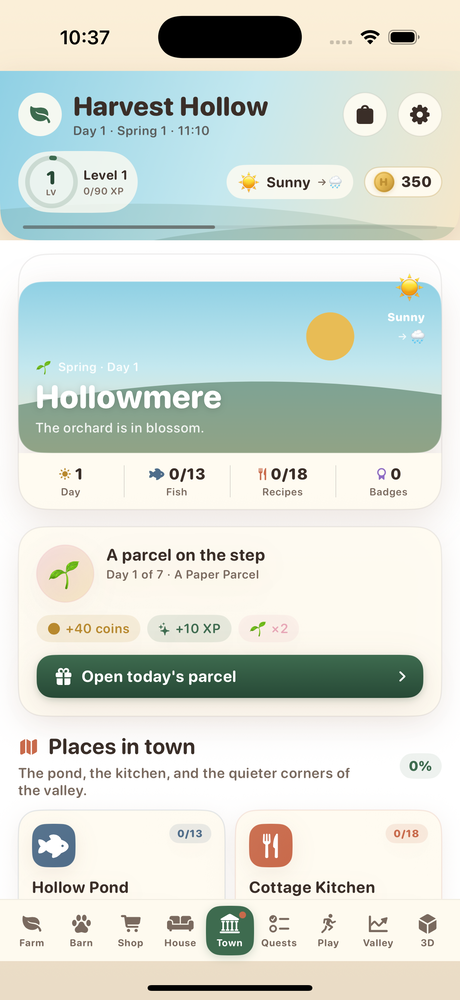
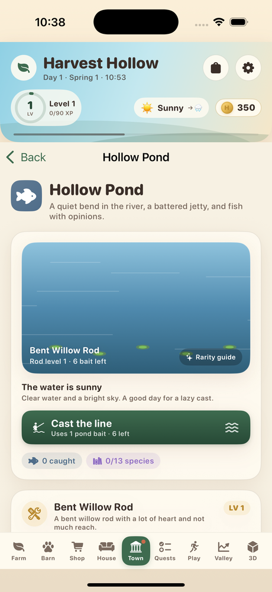
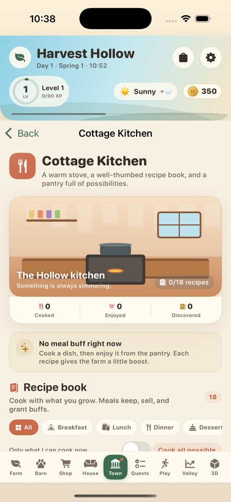
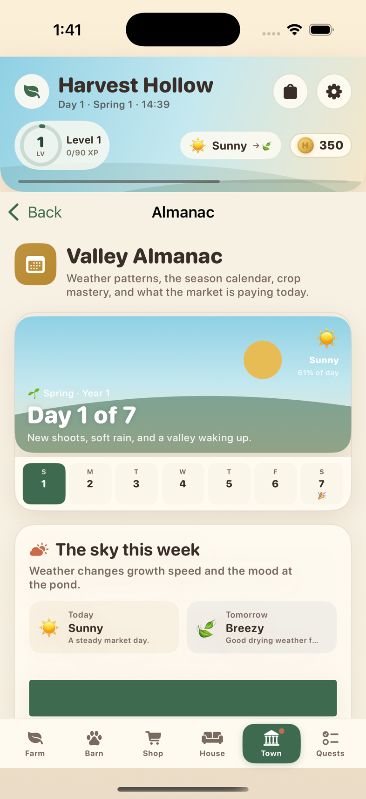

# Harvest Hollow 🌾

**A cozy 2D farming game written entirely in Swift.**

[](https://github.com/yuanjing-sudo/HarvestHollow/actions/workflows/ci.yml)
[](https://github.com/yuanjing-sudo/HarvestHollow/actions/workflows/ios.yml)

Harvest Hollow is a complete, playable farming loop: till the field, plant and water
crops, raise pixel-art animals, sell at a living market, decorate the farmhouse, follow
a ten-chapter story, and level up a little valley farm. The town expansion adds a
fishing pond, a cottage kitchen, an achievement journal, a seasonal almanac, a
collection book, daily gifts, crop mastery, animal affection, a weather forecast, and
full backward-compatible saves. Three new tabs add a complete side-scrolling 2D arcade
called **Meadow Dash**, a 30-factor **Valley Ledger** economy that unlocks in tiers as
you level, and **Hollow 3D**, an orbitable voxel diorama of the whole farm with an
explicit XYZ axis, camera presets, object picking and 74 sculpted models.
Every visual is drawn with SwiftUI `Canvas` from data-driven coloured squares — no PNG
sprite atlases, no web views, no SceneKit, and no JavaScript.

<p align="center">
  
</p>

<p align="center">
  <em>Feed the soil, fill the barn, make the Hollow feel like home.</em>
</p>

<p align="center">
  
  
</p>

<p align="center">
  <em>The real app, captured from the iOS simulator by CI. Weather, levels and prices are live.</em>
</p>

<p align="center">
  
  
  
</p>

<p align="center">
  <em>Pond, kitchen and almanac: three corners of the town expansion, all drawn with SwiftUI Canvas.</em>
</p>


## What is in the game?

| System | What you can do |
| --- | --- |
| **Farm** | 24 plots (6 unlocked), 9 crops, watering, fertilizing, multi-plant, multi-water, multi-harvest, growth stages and weather bonuses |
| **Barn** | 8 pens (2 unlocked), 7 animals, adopt/rename/feed/collect/pet, happiness, affection, production timers, stored goods and two free cycles on adoption |
| **Market** | Buy seeds, feed, bait and fertilizer; buy furniture and house themes; daily price swings; comfort and mastery sale bonuses; daily market order |
| **Inventory** | Filterable satchel with seeds, crops, barn goods, fish, dishes, supplies and furniture; quick plant, feed, eat and sell actions |
| **House** | 14 furniture pieces, drag/arrow placement on a 12×8 room grid, 5 themes, comfort score and up to +25% market bonus |
| **Quests** | 10-chapter story with automatic objective tracking and rewards, plus a daily order |
| **Town** | A navigation hub for the pond, kitchen, almanac, collection, achievements and help guide |
| **Meadow Dash** | A 2D auto-runner with 16 levels, 6 biomes, jumping, double jumps, dashing, sliding, hearts, combos, apples, clovers and persistent best scores |
| **Valley Ledger** | A 30-factor linked economy: soil, weather, yields, livestock, labour, population, demand, prices, inflation, credit, policy, taxes, trade, wellbeing, pollution, research, AI firms, elections and disasters, all unlocking in six tiers |
| **Hollow Exchange** | Live OHLC candles and volume, a 140-factor price model, long **and** short books, a 1x–10x leverage ladder, borrow fees, squeezes, dividends, capital-gains tax, rival dossiers and a full trade blotter |
| **Crime & justice** | Theft, fraud, embezzlement, tax evasion, bribery, smuggling, arson and price-fixing create court cases, damage firm capital and move share prices; forensic audits unlock at level 8 |
| **Policy pass-through** | Every tax, subsidy, spending, tariff and rate change is priced into the exchange in coins and percent, and elections re-price the whole market |
| **Hollow 3D** | A pure-Swift voxel diorama with XYZ axes, a depth-sorted renderer, orbit/pinch camera, six camera presets, object picking, LOD, 74 generated models and a visible Willow Pond with a Visit pond shortcut |
| **Fishing** | 13 fish, 5 rod levels, bait, rarity, time-of-day and weather windows, best catches, a fish journal and upgrade costs; reachable from Town or the new Farm pond card |
| **Cooking** | 18 recipes, 5 categories, ingredient checking, a pantry, sellable dishes and timed growth/market/fishing buffs |
| **Achievements** | 30 long-term goals across fields, barn, market, pond, home and story, with individual and claim-all rewards |
| **Almanac** | Season calendar, festivals, tomorrow's forecast, seven-day weather history, crop mastery and a daily market board |
| **Collection** | Five fillable pages for crops, fish, barn goods, dishes and recipes, with detail sheets and completion progress |
| **Daily gifts** | A seven-day reward cycle, streaks, coins, XP and useful items, with a claimable reminder in the tab bar |
| **Mastery & affection** | Per-crop harvest ranks with sale bonuses; petting, affection levels and faster animal production |
| **Progression** | XP, levels, coin bonuses, crop/animal/plot/pen unlocks, farm records and a trophy |
| **Persistence** | Autosave every 20 seconds, atomic JSON saves with a backup, offline catch-up (capped at 8 hours), export/import save codes, version-tolerant migration from older farms |

### The crops

Wheat, carrot, tomato, strawberry, sunflower, corn, lavender, pumpkin and moonberry.
Each crop has its own growth time, yield, seed cost, sale price, unlock level and
10×10 pixel sprite.

### Meadow Dash

**Meadow Dash** is the interactive 2D page. It is a real automatic runner: the pig
runs through deterministic handcrafted spawns, jumps and double-jumps over fences,
dashes through crates and pumpkins, slides under crows and bees, and collects apples,
golden apples, carrots, clovers, hearts and stars. Sixteen levels span six biomes,
each with its own palette, weather, obstacles and skyline. Runs end with a score,
combo, apple count and up to three stars; best scores, stars, unlocks and lifetime
totals are saved in `ArcadeState`. Successful runs also carry a small, bounded coin
and XP reward back to the farm.

The whole scene — pig, props, parallax hills, windmill, barn, clouds, flowers and
weather — is painted with individual coloured rectangles on SwiftUI `Canvas`.

### Hollow 3D

**Hollow 3D** is a complete voxel diorama of the live farm. The core contains a
pure-Swift perspective renderer with:

- an orbit camera with six presets, pitch clamping and pinch zoom;
- face culling, painter sorting, depth sorting, lighting and optional face edges;
- projected grid and red/green/blue XYZ axis lines;
- tappable object anchors, model bounds and per-object inspection;
- a face cache and minimum-face-area LOD control for smooth interaction.

The model kit contains **74 models and 219,503 voxels**, generated reproducibly by
`Tools/generate_voxel_models.py`. The average animal is deliberately detailed: the pig
alone is built from **2,111 individual voxels**. Buildings, trees, animals, crops,
props and characters all use the same `VoxelModel` format, and the 3D tab populates
its diorama directly from the current save: plots, planted crops, pens, residents,
weather, season and time of day all affect the scene.

### The Valley Ledger

**Valley Ledger** is the economy page — and a real daily simulation behind it. It
starts deliberately small: at level 1 only soil, crop yields, weather, consumer
demand, market prices and player progression are visible. New tiers open at levels 4,
8, 12, 16 and 20, layering on livestock, labour, population, credit, infrastructure,
taxation, trade, elections, research, inequality, pollution, AI agents and global
shocks. Locked factors stay visible with their unlock level so the next layer is
always legible.

Every factor sits in a dependency web rather than a slider bank. Weather and soil set
yields; yields, firm output and imports set supply; household demand, exports and
confidence set prices; prices feed wages, inflation, interest, migration and policy;
policy changes services, taxes, health, education, pollution and the next day's soil.
The page shows the full chain, from **GDP, prices, jobs and happiness** down to active
loans, firm moods, elections and an event history with long-run consequences.

Player levers include tax, subsidy, public spending, tariffs, the policy rate,
eight investment programmes (irrigation, clean energy, roads, schools, clinics,
research, cleanup and digital networks), credit and repayment. Loan interest compounds
daily, credit scores drift with debt and unemployment, weak firms can fail, and
elections can change the ruling party's policy biases. Saves migrate from older
versions and store the entire ledger, including AI citizens and firms.

### The Hollow Exchange

The exchange behind **Valley Ledger → Hollow Exchange** is a full trading desk
rather than a price ticker. Every morning one session runs in a fixed order: rival
firms act, any policy change is priced, then each listing is marked against its own
fair value plus market, sector and technical pressure.

- **140 priced factors** across macro, rates, tax and politics, earnings, supply,
  trade, flows, technicals, derivatives, competitors and global risk. Each factor
  reports a value, a score and the basis points it added or removed from the tape.
- **Real candles.** Every listing stores open/high/low/close plus volume for forty
  sessions, drawn with a candlestick chart, a twenty-day average and volume bars.
- **Bounce and mean reversion.** Prices anchor on their own recent average, snap
  back from stretched z-scores, respect RSI extremes, cluster their volatility and
  are capped by a circuit breaker, so the chart moves like a market instead of a
  random walk.
- **Long and short.** Short selling unlocks at level 4. Cover a short at a profit
  when the price falls, pay borrow fees while it is open, and risk a squeeze if the
  crowd is already short.
- **A leverage ladder.** 1x, 2x, 3x, 5x and 10x unlock at levels 1, 4, 8, 12 and
  16. Higher rungs charge more interest and force a sale at a tighter equity buffer.
- **Taxes and politics that bite.** A tax rise cuts after-tax profit, dividends and
  share prices the next morning; spending and subsidies lift them; tariffs show up
  in consumer prices; elections adopt a platform and re-price the market by several
  percent. The policy panel reports all of it in coins per day and percent.
- **Competitor dossiers.** Every rival has a playbook (price cutter, premium brand,
  volume player, niche specialist, innovator or consolidator), threat level, share
  trend, brand, research, supply security, debt load and a rolling list of real
  moves — price cuts, hiring sprees, product launches, supplier deals, buybacks and
  hostile bids — that move its own share price and the whole valley's competition
  heat.
- **Research sheet.** Ten signals per firm — momentum, stretch, RSI, volatility,
  drawdown, trend, short interest, price to book, dividend yield and fraud risk —
  plus a plain-language verdict before you trade.

### The pond

The Hollow pond holds thirteen fish across five rarities: common, uncommon, rare,
epic and legendary. Each cast costs one pond bait and rolls against the fish's unlock
rod level, preferred weather, time-of-day window and the current fishing buff. The
rod has five levels; better rods unlock rarer residents and improve the odds. The
journal keeps catch counts and best weights, and the kitchen turns some catches into
meals.

### The kitchen

Eighteen recipes span breakfast, lunch, dinner, dessert and drinks. Recipes unlock
with farmer levels, consume real ingredients from the satchel, and produce dishes that
can be sold or eaten. Eating applies a timed buff: faster crop growth, better market
prices, or improved rare-fish odds. The largest feast needs a legendary sturgeon and
the best the valley grows.

### The barn friends

Chicken, duck, cow, sheep, pig, goat and bee. A pig is built from individual pink
squares with ears, snout, eyes and trotters; the bee has wings and stripes. Every
animal is a hand-authored grid of coloured cells, not an emoji or an image file.

| Animal | Product | Base production |
| --- | --- | --- |
| Chicken | Egg | 50s |
| Duck | Duck egg | 55s |
| Cow | Milk | 90s |
| Sheep | Wool | 120s |
| Pig | Truffle | 100s |
| Goat | Goat milk | 80s |
| Bee | Honey | 60s |

## Playing

- **Plant:** pick a seed in the satchel strip, then tap any empty plot.
- **Water:** tap a thirsty crop or use **Water all**. Rain waters everything for free
  at the start of a rainy day.
- **Harvest:** tap a ripe crop (golden sparkle badge) or use **Harvest all**.
- **Fertilize:** long-press a growing plot, or open its detail sheet. Fertilizer
  grows 50% faster and adds +1 yield.
- **Animals:** open the Barn tab, tap an empty pen, choose a friend, then feed and
  collect. One feed bag lasts two production cycles.
- **Sell:** visit the Market tab and switch to **Sell**. Prices move daily; comfort
  from the farmhouse adds a bonus to every sale.
- **Decorate:** buy furniture at the market, open the House tab, choose a piece from
  the shelf, and tap the room. Drag a placed piece or use the arrow controls to nudge it.
- **Progress:** quests complete automatically. Level-ups unlock new crops, animals,
  plots and pens.
- **Fish:** open **Town → Hollow Pond**, buy bait at the market, and cast. Check the
  journal for which fish prefer rain, dawn, dusk or night.
- **Cook:** open **Town → Cottage Kitchen**, pick a recipe whose ingredients you own,
  cook it, then eat from the pantry for a timed buff.
- **Claim:** the Town tab shows a dot when a daily gift or achievement reward is
  ready. The gift cycles through seven days and builds a streak.
- **Read the sky:** tap the weather chip in the header or open the Almanac. Tomorrow's
  weather is always shown before it arrives.
- **Run the valley:** open **Valley** to read the ledger. Factor tiles start small and
  unlock in tiers; policy, investment and borrowing open at level 8. Watch how a
  drought, a tax change, or a new school travels through prices and wellbeing.

The in-game day lasts four real minutes. A long break rolls days forward and catches
up crops and animal production for up to eight hours.

## Architecture

The package is deliberately split so the simulation runs anywhere Swift runs —
including Linux CI — while the presentation layer is native SwiftUI.

```
HarvestHollow/
├── Package.swift
├── Sources/
│   ├── HarvestHollowCore/     # Pure Swift simulation, no UI imports
│   │   ├── Models.swift       # GameState, weather, plots, crops, animals, quests
│   │   ├── Activities.swift   # Seasons, fish, recipes, buffs, mastery, achievements
│   │   ├── ActivityCatalog.swift # Fish, recipe, achievement and daily-gift content
│   │   ├── Catalog.swift      # Crops, animals, furniture, themes, quests, items
│   │   ├── Engine.swift       # Tick loop, actions, validation, events, progression
│   │   ├── Arcade.swift       # Meadow Dash levels, physics, scoring and career
│   │   ├── EconomyModels.swift # Tiers, 30-factor catalogue, loans, firms, events
│   │   ├── ValleyEconomy.swift # Persistent ledger, derived values and factor readings
│   │   ├── EconomySimulation.swift # Daily linked simulation and reporting
│   │   ├── EconomyEvents.swift # Firms, elections, random shocks and consequences
│   │   ├── EconomyActions.swift # Policy, investment and credit actions
│   │   ├── MarketDynamics.swift # Candles, 140-factor model, signals and regimes
│   │   ├── MarketTrading.swift # Short book, leverage ladder, borrow fees and squeezes
│   │   ├── MarketSession.swift # Daily session: rivals, policy shock, prices, index
│   │   ├── MarketPolitics.swift # Policy pass-through and election forecasts
│   │   ├── MarketCompetitors.swift # Rival dossiers, strategies and daily moves
│   │   ├── VoxelGeometry.swift # Vec math, voxel models, faces and builders
│   │   ├── VoxelRenderer.swift # Orbit camera, culling, lighting, picking and LOD
│   │   ├── VoxelModelLibrary.swift # Model codec, inspector and face cache
│   │   ├── VoxelWorld.swift   # Live farm diorama and camera presets
│   │   ├── Voxel*Models.swift # 74 generated voxel models (220k lines)
│   │   ├── Market.swift       # Deterministic daily price multipliers
│   │   ├── Persistence.swift  # JSON save codec, atomic store, export/import
│   │   └── PixelArt.swift     # 69 data-driven pixel sprites
│   ├── HarvestHollowUI/       # SwiftUI screens and reusable components
│   │   ├── FarmView.swift
│   │   ├── BarnView.swift
│   │   ├── MarketView.swift
│   │   ├── HouseView.swift
│   │   ├── QuestsView.swift
│   │   ├── TownView.swift
│   │   ├── FishingView.swift
│   │   ├── KitchenView.swift
│   │   ├── AchievementsView.swift
│   │   ├── AlmanacView.swift
│   │   ├── CollectionView.swift
│   │   ├── HelpView.swift
│   │   ├── ArcadeView.swift   # Interactive 2D Meadow Dash page
│   │   ├── EconomyView.swift  # Valley Ledger dashboard, policies and credit
│   │   ├── EconomyComponents.swift # Sparklines, factor tiles, detail and guide
│   │   ├── InvestmentView.swift # Hollow Exchange, candles and crime ledger
│   │   ├── MarketPanels.swift  # Candle chart, factor board, policy and rival panels
│   │   ├── BusinessDetailView.swift # Firm fundamentals, trading and audits
│   │   ├── World3DView.swift  # Interactive XYZ voxel farm page
│   │   ├── WeatherSheet.swift
│   │   ├── InventorySheet.swift
│   │   ├── SettingsSheet.swift
│   │   ├── RootView.swift
│   │   ├── GameStore.swift
│   │   ├── TownComponents.swift
│   │   ├── Components.swift
│   │   └── Theme.swift
│   └── HarvestHollowCLI/      # Headless demo, sprite browser, validator
├── Tests/                     # 114 core simulation, economy, market and voxel/arcade tests
├── Apps/HarvestHollow/        # iOS app target (XcodeGen project)
├── Tools/                     # Icon, sprite-sheet and voxel-model generators
└── docs/
```

`HarvestHollowCore` owns a value-type `GameState`, advances it with a deterministic
tick, validates every action and emits lightweight events for toasts and level-ups.
`GameStore` is the SwiftUI bridge: it owns the engine, drives a 1-second timer,
autosaves, queues feedback and exposes the state as `ObservableObject`.

### Pixel art from coloured squares

Each sprite is a small ASCII grid plus a palette:

```swift
PixelSprite(
    key: "animal.pig",
    width: 14,
    palette: ["p": "F3A6B8", "d": "D97B92", "k": "2B1B1B", ...],
    rows: [
        "...oo....oo...",
        "..oppo..oppo..",
        ...
    ]
)
```

`PixelSpriteView` renders every non-`.` cell as its own square on a SwiftUI `Canvas`,
scaled with integer-friendly nearest-neighbour geometry. Tests assert every row is the
declared width and every character has a palette colour. The CLI's `validate` command
checks all 69 sprites, and the sprite sheet above is generated straight from
`PixelArt.swift`.

## Run it

### Requirements

- **iOS 17+** or **macOS 14+**
- **Xcode 15+** (Swift 5.9 toolchain or newer)
- [XcodeGen](https://github.com/yonaskolb/XcodeGen) for the iOS app project:
  `brew install xcodegen`

### iOS app

```bash
git clone https://github.com/yuanjing-sudo/HarvestHollow.git
cd HarvestHollow/Apps/HarvestHollow
xcodegen generate
open HarvestHollow.xcodeproj
```

Select the `HarvestHollow` scheme, choose an iPhone/iPad simulator, and run. To use a
physical device, set your development team in the target's **Signing & Capabilities**
tab. The app target consumes the repository as a local Swift package
(`HarvestHollowUI`), so there is nothing else to install.

### Package, tests and CLI

```bash
swift build
swift test                              # 114 tests
swift run harvesthollow demo            # full headless gameplay loop
swift run harvesthollow sprites pig     # terminal sprite browser
swift run harvesthollow validate        # check all 69 sprite grids
```

The CLI uses ANSI colours in a terminal. On Linux, `HarvestHollowUI` compiles as an
empty compatibility target because SwiftUI is unavailable; the core and CLI still
build and test normally.

## Saving

- Save file: `Application Support/HarvestHollow/save.json`, with a
  `save.backup.json` written before each successful overwrite.
- Autosave runs every 20 seconds and when the app leaves the foreground.
- On launch the game simulates offline time, capped at 8 hours, so crops can finish
  and animals can produce while the app is closed.
- **Settings → Export code / Import** moves a base64 JSON save between devices.
- Saves are versioned. Farms created before the town expansion or Meadow Dash load
  with sensible defaults for forecast, activities, fishing, cooking, achievements,
  affection, gifts and arcade career; the decoder fills missing fields instead of
  rejecting the save.

## Testing

The test suite covers planting, growth, weather, harvesting, animal feeding and
production, petting and affection, inventory, buying/selling, market multipliers,
plot/pen unlocks, furniture placement, themes, quests, level-ups, offline catch-up,
fishing and bait, rod upgrades, cooking and buffs, daily gifts and streaks,
achievements, crop mastery, weather forecasting, collection counts, save round-trips,
legacy-save migration, import/export, sprite integrity, voxel geometry and rendering,
model-library integrity, Meadow Dash physics and progression, share-price simulation,
cash and margin trading, forensic audits, crime generation, and save migration for
the arcade career and the Hollow Exchange.

```bash
swift test
# Executed 114 tests, with 0 failures
```

## Regenerating art assets

```bash
python3 Tools/make_icon.py             # docs/icon.png → app icon set
python3 Tools/make_sprite_sheet.py     # docs/sprites.png from PixelArt.swift
python3 Tools/generate_voxel_models.py # Sources/HarvestHollowCore/Voxel*Models.swift
```

Both scripts use only the Python standard library.

## License

MIT © 2026 yuanjing-sudo. See [LICENSE](LICENSE).

---

Made with care in the Hollow — SwiftUI + Swift, all the way down.
