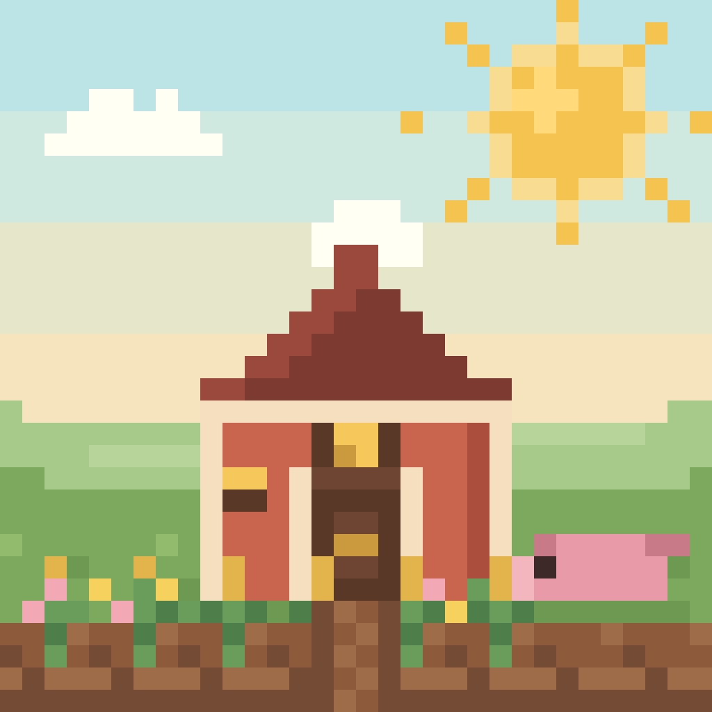
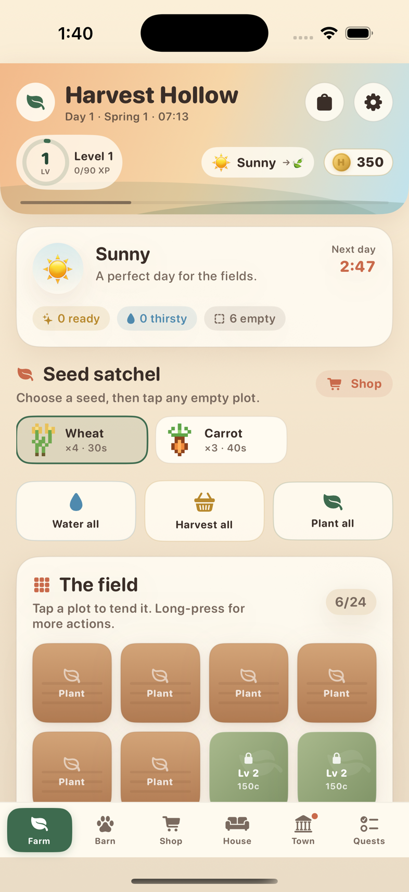
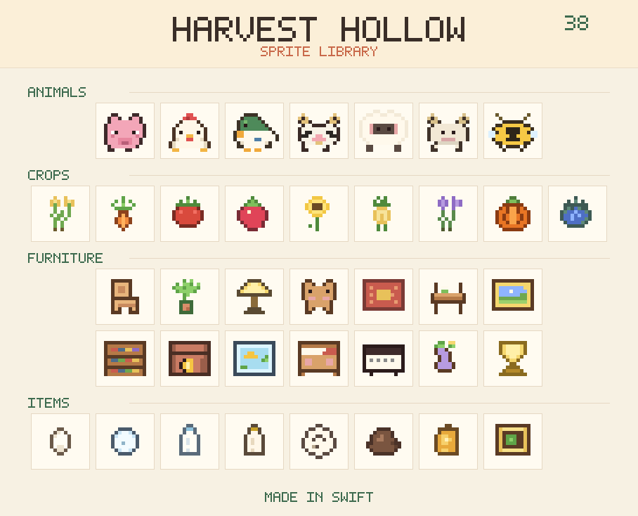

# Harvest Hollow 🌾

**A cozy 2D farming game written entirely in Swift.**

[](https://github.com/yuanjing-sudo/HarvestHollow/actions/workflows/ci.yml)
[](https://github.com/yuanjing-sudo/HarvestHollow/actions/workflows/ios.yml)

Harvest Hollow is a complete, playable farming loop: till the field, plant and water
crops, raise pixel-art animals, sell at a living market, decorate the farmhouse, follow
a ten-chapter story, and level up a little valley farm. The town expansion adds a
fishing pond, a cottage kitchen, an achievement journal, a seasonal almanac, a
collection book, daily gifts, crop mastery, animal affection, a weather forecast, and
full backward-compatible saves. Every visual is drawn with SwiftUI `Canvas` from
data-driven coloured squares — no PNG sprite atlases, no web views, and no JavaScript.

<p align="center">
  
</p>

<p align="center">
  <em>Feed the soil, fill the barn, make the Hollow feel like home.</em>
</p>

<p align="center">
  
</p>

<p align="center">
  <em>The real app, captured from the iOS simulator by CI. Weather, levels and prices are live.</em>
</p>



## What is in the game?

| System | What you can do |
| --- | --- |
| **Farm** | 24 plots (6 unlocked), 9 crops, watering, fertilizing, multi-plant, multi-water, multi-harvest, growth stages and weather bonuses |
| **Barn** | 8 pens (2 unlocked), 7 animals, adopt/rename/feed/collect, happiness, production timers, stored goods and two free cycles on adoption |
| **Market** | Buy seeds, feed and fertilizer; buy furniture and house themes; daily price swings; comfort sale bonus; daily market order |
| **Inventory** | Filterable satchel with seeds, crops, barn goods, supplies and furniture; quick plant, feed and sell actions |
| **House** | 14 furniture pieces, drag/arrow placement on a 12×8 room grid, 5 themes, comfort score and up to +25% market bonus |
| **Quests** | 10-chapter story with automatic objective tracking and rewards, plus a daily order |
| **Town** | A navigation hub for the pond, kitchen, almanac, collection, achievements and help guide |
| **Fishing** | 13 fish, 5 rod levels, bait, rarity, time-of-day and weather windows, best catches, a fish journal and upgrade costs |
| **Cooking** | 18 recipes, 5 categories, ingredient checking, a pantry, sellable dishes and timed growth/market/fishing buffs |
| **Achievements** | 30 long-term goals across fields, barn, market, pond, home and story, with individual and claim-all rewards |
| **Almanac** | Season calendar, festivals, tomorrow's forecast, seven-day weather history, crop mastery and a daily market board |
| **Collection** | Five fillable pages for crops, fish, barn goods, dishes and recipes, with detail sheets and completion progress |
| **Daily gifts** | A seven-day reward cycle, streaks, coins, XP and useful items, with a claimable reminder in the tab bar |
| **Mastery & affection** | Per-crop harvest ranks with sale bonuses; petting, affection levels and faster animal production |
| **Progression** | XP, levels, coin bonuses, crop/animal/plot/pen unlocks, farm records and a trophy |
| **Persistence** | Autosave every 20 seconds, atomic JSON saves with a backup, offline catch-up (capped at 8 hours), export/import save codes, version-tolerant migration from older farms |

### The crops

Wheat, carrot, tomato, strawberry, sunflower, corn, lavender, pumpkin and moonberry.
Each crop has its own growth time, yield, seed cost, sale price, unlock level and
10×10 pixel sprite.

### The pond

The Hollow pond holds thirteen fish across five rarities: common, uncommon, rare,
epic and legendary. Each cast costs one pond bait and rolls against the fish's unlock
rod level, preferred weather, time-of-day window and the current fishing buff. The
rod has five levels; better rods unlock rarer residents and improve the odds. The
journal keeps catch counts and best weights, and the kitchen turns some catches into
meals.

### The kitchen

Eighteen recipes span breakfast, lunch, dinner, dessert and drinks. Recipes unlock
with farmer levels, consume real ingredients from the satchel, and produce dishes that
can be sold or eaten. Eating applies a timed buff: faster crop growth, better market
prices, or improved rare-fish odds. The largest feast needs a legendary sturgeon and
the best the valley grows.

### The barn friends

Chicken, duck, cow, sheep, pig, goat and bee. A pig is built from individual pink
squares with ears, snout, eyes and trotters; the bee has wings and stripes. Every
animal is a hand-authored grid of coloured cells, not an emoji or an image file.

| Animal | Product | Base production |
| --- | --- | --- |
| Chicken | Egg | 50s |
| Duck | Duck egg | 55s |
| Cow | Milk | 90s |
| Sheep | Wool | 120s |
| Pig | Truffle | 100s |
| Goat | Goat milk | 80s |
| Bee | Honey | 60s |

## Playing

- **Plant:** pick a seed in the satchel strip, then tap any empty plot.
- **Water:** tap a thirsty crop or use **Water all**. Rain waters everything for free
  at the start of a rainy day.
- **Harvest:** tap a ripe crop (golden sparkle badge) or use **Harvest all**.
- **Fertilize:** long-press a growing plot, or open its detail sheet. Fertilizer
  grows 50% faster and adds +1 yield.
- **Animals:** open the Barn tab, tap an empty pen, choose a friend, then feed and
  collect. One feed bag lasts two production cycles.
- **Sell:** visit the Market tab and switch to **Sell**. Prices move daily; comfort
  from the farmhouse adds a bonus to every sale.
- **Decorate:** buy furniture at the market, open the House tab, choose a piece from
  the shelf, and tap the room. Drag a placed piece or use the arrow controls to nudge it.
- **Progress:** quests complete automatically. Level-ups unlock new crops, animals,
  plots and pens.
- **Fish:** open **Town → Hollow Pond**, buy bait at the market, and cast. Check the
  journal for which fish prefer rain, dawn, dusk or night.
- **Cook:** open **Town → Cottage Kitchen**, pick a recipe whose ingredients you own,
  cook it, then eat from the pantry for a timed buff.
- **Claim:** the Town tab shows a dot when a daily gift or achievement reward is
  ready. The gift cycles through seven days and builds a streak.
- **Read the sky:** tap the weather chip in the header or open the Almanac. Tomorrow's
  weather is always shown before it arrives.

The in-game day lasts four real minutes. A long break rolls days forward and catches
up crops and animal production for up to eight hours.

## Architecture

The package is deliberately split so the simulation runs anywhere Swift runs —
including Linux CI — while the presentation layer is native SwiftUI.

```
HarvestHollow/
├── Package.swift
├── Sources/
│   ├── HarvestHollowCore/     # Pure Swift simulation, no UI imports
│   │   ├── Models.swift       # GameState, weather, plots, crops, animals, quests
│   │   ├── Activities.swift   # Seasons, fish, recipes, buffs, mastery, achievements
│   │   ├── ActivityCatalog.swift # Fish, recipe, achievement and daily-gift content
│   │   ├── Catalog.swift      # Crops, animals, furniture, themes, quests, items
│   │   ├── Engine.swift       # Tick loop, actions, validation, events, progression
│   │   ├── Market.swift       # Deterministic daily price multipliers
│   │   ├── Persistence.swift  # JSON save codec, atomic store, export/import
│   │   └── PixelArt.swift     # 69 data-driven pixel sprites
│   ├── HarvestHollowUI/       # SwiftUI screens and reusable components
│   │   ├── FarmView.swift
│   │   ├── BarnView.swift
│   │   ├── MarketView.swift
│   │   ├── HouseView.swift
│   │   ├── QuestsView.swift
│   │   ├── TownView.swift
│   │   ├── FishingView.swift
│   │   ├── KitchenView.swift
│   │   ├── AchievementsView.swift
│   │   ├── AlmanacView.swift
│   │   ├── CollectionView.swift
│   │   ├── HelpView.swift
│   │   ├── WeatherSheet.swift
│   │   ├── InventorySheet.swift
│   │   ├── SettingsSheet.swift
│   │   ├── RootView.swift
│   │   ├── GameStore.swift
│   │   ├── TownComponents.swift
│   │   ├── Components.swift
│   │   └── Theme.swift
│   └── HarvestHollowCLI/      # Headless demo, sprite browser, validator
├── Tests/                     # 61 core simulation tests
├── Apps/HarvestHollow/        # iOS app target (XcodeGen project)
├── Tools/                     # Reproducible icon + sprite-sheet generators
└── docs/
```

`HarvestHollowCore` owns a value-type `GameState`, advances it with a deterministic
tick, validates every action and emits lightweight events for toasts and level-ups.
`GameStore` is the SwiftUI bridge: it owns the engine, drives a 1-second timer,
autosaves, queues feedback and exposes the state as `ObservableObject`.

### Pixel art from coloured squares

Each sprite is a small ASCII grid plus a palette:

```swift
PixelSprite(
    key: "animal.pig",
    width: 14,
    palette: ["p": "F3A6B8", "d": "D97B92", "k": "2B1B1B", ...],
    rows: [
        "...oo....oo...",
        "..oppo..oppo..",
        ...
    ]
)
```

`PixelSpriteView` renders every non-`.` cell as its own square on a SwiftUI `Canvas`,
scaled with integer-friendly nearest-neighbour geometry. Tests assert every row is the
declared width and every character has a palette colour. The CLI's `validate` command
checks all 69 sprites, and the sprite sheet above is generated straight from
`PixelArt.swift`.

## Run it

### Requirements

- **iOS 17+** or **macOS 14+**
- **Xcode 15+** (Swift 5.9 toolchain or newer)
- [XcodeGen](https://github.com/yonaskolb/XcodeGen) for the iOS app project:
  `brew install xcodegen`

### iOS app

```bash
git clone https://github.com/yuanjing-sudo/HarvestHollow.git
cd HarvestHollow/Apps/HarvestHollow
xcodegen generate
open HarvestHollow.xcodeproj
```

Select the `HarvestHollow` scheme, choose an iPhone/iPad simulator, and run. To use a
physical device, set your development team in the target's **Signing & Capabilities**
tab. The app target consumes the repository as a local Swift package
(`HarvestHollowUI`), so there is nothing else to install.

### Package, tests and CLI

```bash
swift build
swift test                              # 61 tests
swift run harvesthollow demo            # full headless gameplay loop
swift run harvesthollow sprites pig     # terminal sprite browser
swift run harvesthollow validate        # check all 69 sprite grids
```

The CLI uses ANSI colours in a terminal. On Linux, `HarvestHollowUI` compiles as an
empty compatibility target because SwiftUI is unavailable; the core and CLI still
build and test normally.

## Saving

- Save file: `Application Support/HarvestHollow/save.json`, with a
  `save.backup.json` written before each successful overwrite.
- Autosave runs every 20 seconds and when the app leaves the foreground.
- On launch the game simulates offline time, capped at 8 hours, so crops can finish
  and animals can produce while the app is closed.
- **Settings → Export code / Import** moves a base64 JSON save between devices.
- Saves are versioned. Farms created before the town expansion load with sensible
  defaults for forecast, activities, fishing, cooking, achievements, affection and
  gift state; the decoder fills missing fields instead of rejecting the save.

## Testing

The test suite covers planting, growth, weather, harvesting, animal feeding and
production, petting and affection, inventory, buying/selling, market multipliers,
plot/pen unlocks, furniture placement, themes, quests, level-ups, offline catch-up,
fishing and bait, rod upgrades, cooking and buffs, daily gifts and streaks,
achievements, crop mastery, weather forecasting, collection counts, save round-trips,
legacy-save migration, import/export and sprite integrity.

```bash
swift test
# Executed 61 tests, with 0 failures
```

## Regenerating art assets

```bash
python3 Tools/make_icon.py          # docs/icon.png → app icon set
python3 Tools/make_sprite_sheet.py  # docs/sprites.png from PixelArt.swift
```

Both scripts use only the Python standard library.

## License

MIT © 2026 yuanjing-sudo. See [LICENSE](LICENSE).

---

Made with care in the Hollow — SwiftUI + Swift, all the way down.
